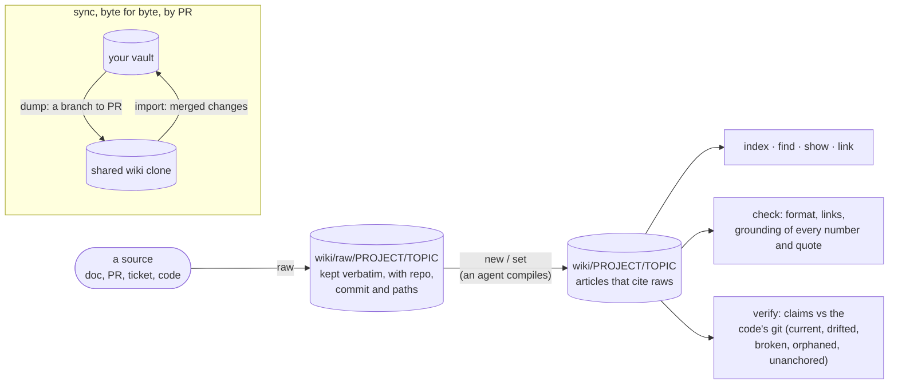
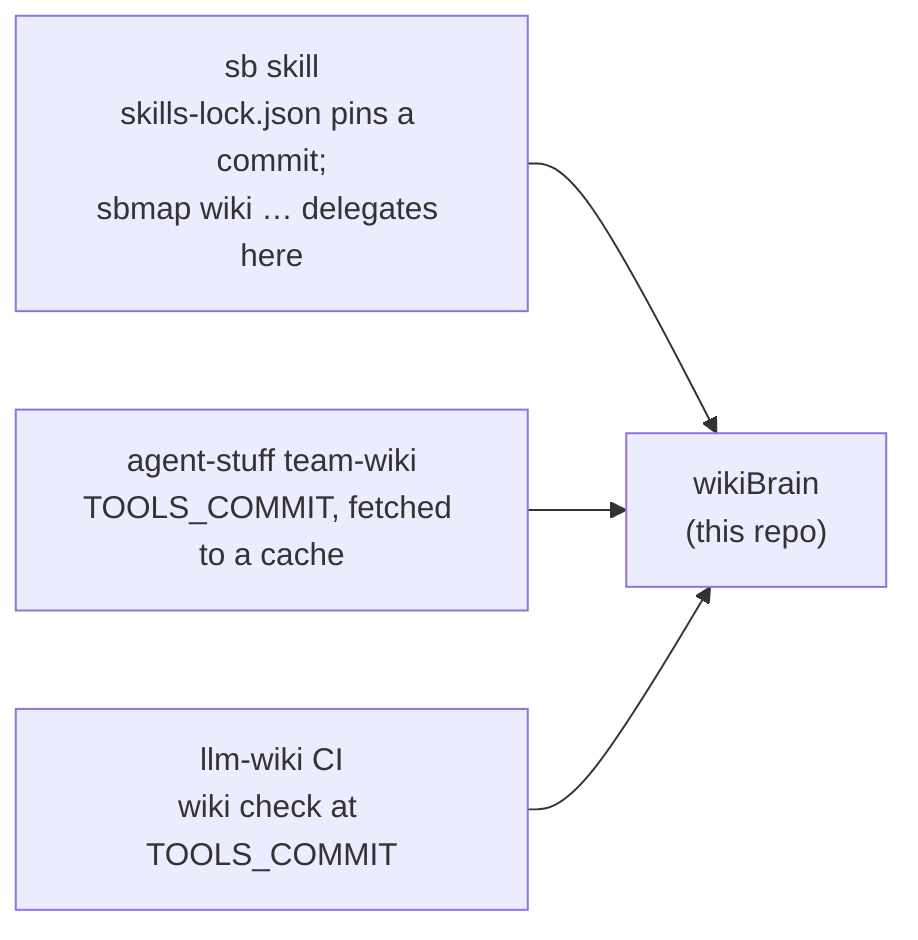

# wikiBrain

The tools of an LLM wiki: [Karpathy's LLM-wiki pattern](https://github.com/astro-han/karpathy-llm-wiki)
(sources kept, articles compiled from them, cited, compounding) in a typed, Obsidian-friendly format:
every field a property, every reference a full-path wikilink. One skill, `skills/wikibrain/`, that the
[sb](https://github.com/DanAmador/SB) workflow and team wikis such as
[assemblio-development/llm-wiki](https://github.com/assemblio-development/llm-wiki) build on.

## How it works



## Commands

`SB_VAULT=<folder holding wiki/> python3 skills/wikibrain/scripts/wikibrain.py <command>`; no command lists them.

| | command | does |
|---|---|---|
| read | `index [--project P] [--write]` | every project, topic and article, one line each; `--write` restamps `wiki/index.md` |
| | `find <terms…> [--raw]` | notes matching any term, scored by title, summary and body |
| | `show <note> [--full]` | properties, overview, headings, outdated and disputed callouts |
| | `link <note>` | the full-path wikilink to paste into prose |
| | `backlog` | raw notes no article cites yet |
| | `verify [--repo-root <clone>]` | each article's claims against the repo's git |
| write | `init` | the layout, never overwriting |
| | `raw <project>/<topic> --title … --source … --from <file> [--repo-root <clone> --paths …]` | keeps a source as a raw note, stamped with where it was read |
| | `new <project>/<topic>/<slug> …` | scaffolds an article citing its raws |
| | `set <note> key=value …`, `log …` | changes properties, appends to the log |
| | `check [--fix]`, `migrate` | lint (CI runs it), move an old layout under projects |
| sync | `dump <clone> [--projects a,b] [--exclude p/topic]` | your notes onto a `wiki-dump/<date>` branch of the clone, with a ready PR description; never pushes |
| | `import <clone>` | merged changes back into your vault; a note changed on both sides is listed, never overwritten |

The format, properties, links, grounding and how to write a finding: [skills/wikibrain/reference/wiki.md](skills/wikibrain/reference/wiki.md).

## Who uses it



- **As a skill:** `npx skills add DanAmador/wikiBrain -g -s wikibrain`.
- **Pinned from another repo:** reference a commit, as sb does in its `skills-lock.json`, or fetch the
  three scripts (`wikibrain.py`, `vault.py`, `wikisync.py`) at a commit, as team-wiki does. Want to
  change it for your team? Fork it and pin your fork.

## Tests

```bash
python3 -m unittest discover tests
```

Standard library only (plus `git` for provenance, verify and sync). MIT.
